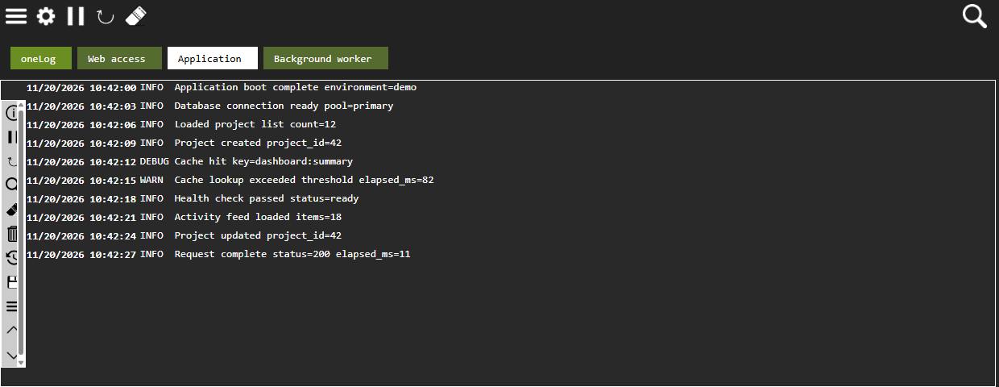

# Log-Hog

Log-Hog is a browser-based log viewer for development machines. Watch files and folders, filter log output, follow several logs side by side, and save entries to history or archives.



The `9.0` image supports `linux/amd64` and `linux/arm64`. Run it with Docker Engine on Linux or Docker Desktop on Windows and macOS. Pin `mreishman/loghog:9.0` for a specific release or use `mreishman/loghog:latest` to follow stable releases.

## Quick start

Save this as `compose.yaml` in a directory of your choice. Set `LOGHOG_LOG_DIR` to an existing host folder that contains logs.

```yaml
name: loghog-hub
services:
  loghog:
    image: mreishman/loghog:9.0
    ports:
      - "127.0.0.1:1337:80"
    volumes:
      - settings:/var/www/html/local
      - history:/var/www/html/tmp
      - type: bind
        source: "${LOGHOG_LOG_DIR:?Set LOGHOG_LOG_DIR to an existing log folder}"
        target: /var/www/logs
        read_only: true
        bind:
          create_host_path: false

volumes:
  settings:
  history:
```

| Terminal | Example command |
| --- | --- |
| Windows PowerShell | `$env:LOGHOG_LOG_DIR = 'C:/Logs'` |
| WSL with logs on the Windows C: drive | `export LOGHOG_LOG_DIR=/mnt/c/Logs` |
| Ubuntu or macOS | `export LOGHOG_LOG_DIR="$HOME/logs"` |

Run `docker compose up -d` in the same terminal. Open [http://localhost:1337](http://localhost:1337), complete setup, then add `/var/www/logs` or a file such as `/var/www/logs/app.log` to the Log-Hog watch list. Add more bind mounts with distinct container paths, such as `/var/www/logs/nginx` and `/var/www/logs/worker`, if your logs live in separate host folders.

## Run without Compose

Replace `/absolute/path/to/logs` with an existing folder, for example `C:/Logs` in PowerShell. Keep the mount argument quoted if the host path contains spaces.

```text
docker run -d --name loghog -p 127.0.0.1:1337:80 --mount type=volume,source=loghog-settings,target=/var/www/html/local --mount type=volume,source=loghog-history,target=/var/www/html/tmp --mount "type=bind,source=/absolute/path/to/logs,target=/var/www/logs,readonly" mreishman/loghog:9.0
```

## Upgrades and data

The settings volume stores setup state, profiles, watch lists, and custom themes. The history volume stores saved logs and archives. Keep both volumes and reuse the same Compose project name when replacing the container. Avoid `docker compose down -v` if you want to keep the data.

To upgrade, back up both volumes, set `image:` to your chosen tag, and run `docker compose pull` followed by `docker compose up -d`. Keep your container-side log paths the same so existing watch lists continue to work. If you're migrating from an older container, back up its existing settings and history before creating the replacement. [Upgrade and backup details](https://github.com/mreishman/Log-Hog/blob/develop/README.md#keep-and-back-up-settings)

Log mounts are read-only in these examples. The container's `www-data` user needs permission to list the folders and read the files. Enable write access on a specific mount if you need Log-Hog to clear, trim, or delete those logs.

- [Source and full documentation](https://github.com/mreishman/Log-Hog)
- [Release notes](https://github.com/mreishman/Log-Hog/releases)
- [Report an issue](https://github.com/mreishman/Log-Hog/issues)
