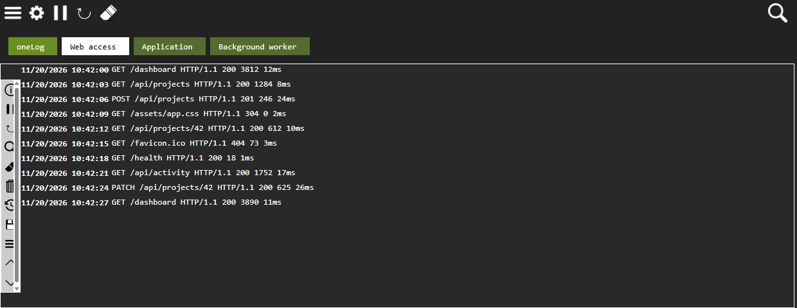
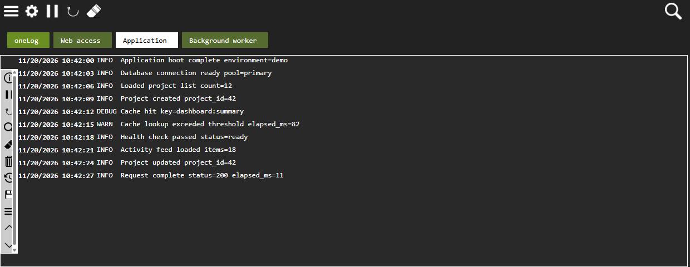
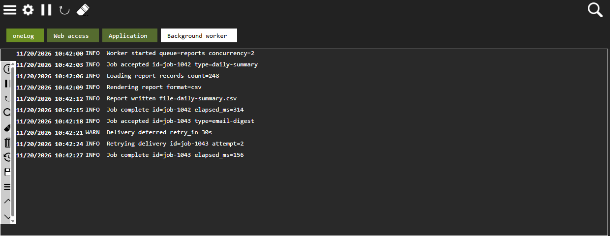

# Log-Hog

Log-Hog watches log files and folders from a browser. Use it to follow updates across multiple logs, filter output, and save log history on a development machine.

## Screenshots

The screenshots show three sample logs with synthetic data.

### Web access



### Application



### Background worker



## Run with Docker

### Install Docker

- **Ubuntu:** Install Docker Engine and the Compose plugin. If Docker reports a socket permission error, follow Docker's Linux post-install instructions or run the Docker commands with `sudo`. [Install on Ubuntu](https://docs.docker.com/engine/install/ubuntu/) · [Linux post-install steps](https://docs.docker.com/engine/install/linux-postinstall/)
- **macOS:** Install Docker Desktop for your Mac's processor (Apple silicon or Intel) and open it before running Compose. If Docker reports that a bind mount is denied, check **Settings → Resources → File sharing** and make the host folder available to Docker. [Install on Mac](https://docs.docker.com/desktop/setup/install/mac-install/) · [File sharing settings](https://docs.docker.com/desktop/settings-and-maintenance/settings/#file-sharing)
- **Windows and WSL:** Start Docker Desktop. If you run commands from Ubuntu under WSL, enable Docker Desktop integration for that distribution. [Docker Desktop WSL integration](https://docs.docker.com/desktop/features/wsl/)

Confirm Docker is ready from the terminal you plan to use.

```sh
docker info
docker compose version
```

### Start Log-Hog with Compose

The [Compose file](docker-compose.yml) builds Log-Hog on the official PHP 8.6.0 Apache image. From the repository directory, set `LOGHOG_LOG_DIR` to an existing host folder that contains your logs. Set it in the same shell where you run Compose.

| Where you run Compose | Example command |
| --- | --- |
| Windows PowerShell | `$env:LOGHOG_LOG_DIR = 'C:/Logs'` |
| WSL with logs on the Windows C: drive | `export LOGHOG_LOG_DIR=/mnt/c/Logs` |
| Ubuntu | `export LOGHOG_LOG_DIR="$HOME/logs"` |
| macOS | `export LOGHOG_LOG_DIR="$HOME/logs"` |

Create the host folder first if needed, for example with `mkdir -p "$HOME/logs"` on Ubuntu or macOS. Compose defaults to `/var/www/logs` on the host if the variable is unset. The container sees the chosen folder at `/var/www/logs` on every platform. On Ubuntu, if you run Compose with `sudo`, pass the log folder explicitly with `sudo env "LOGHOG_LOG_DIR=$LOGHOG_LOG_DIR" docker compose up -d --build`.

```sh
docker compose up -d --build
```

Open [http://localhost:1337](http://localhost:1337), complete setup, and add a path such as `/var/www/logs/nginx/access.log` to the watch list. The default port mapping publishes port 1337 on all host interfaces. For access from this machine only, change the mapping to `"127.0.0.1:1337:80"`.

### Run from the Docker Desktop Images screen

Use **Images → Run** to create a standalone container. If `loghog:local` is missing from the Images list, build it from the repository directory with `docker compose build`. [Docker Desktop Images](https://docs.docker.com/desktop/use-desktop/images/#run-an-image-as-a-container)

To keep your settings and history in host folders you can browse in Finder or Explorer, prepare the folders before opening the dialog. Use a new data directory so the example can copy the image's starter files into it.

On macOS, run the following in Terminal:

```sh
data_dir="$HOME/LogHogData"
mkdir "$data_dir"
seed=$(docker create loghog:local)
docker cp "${seed}:/var/www/html/local" "$data_dir/local"
docker cp "${seed}:/var/www/html/tmp" "$data_dir/history"
docker rm "$seed"
```

On Windows, run the following in PowerShell:

```powershell
New-Item -ItemType Directory -Path C:/LogHogData
$seed = docker create loghog:local
docker cp "${seed}:/var/www/html/local" C:/LogHogData/local
docker cp "${seed}:/var/www/html/tmp" C:/LogHogData/history
docker rm $seed
```

For an existing installation, use your backed-up `local` and `tmp` directories instead. The `local` host folder must contain the complete profile tree and `layout.php`. An empty folder mounted there hides the image's starter files.

1. In Docker Desktop, open **Images**, find `loghog:local`, select **Run**, and expand **Optional settings**.
2. Set **Container name** to `loghog-desktop`. In **Ports**, enter `1337` as the **Host port** for `80/tcp`. Choose an unused port such as `1338` if Compose is already using `1337`.
3. Under **Volumes**, enter the host and container paths below. Use **+** to add rows. Add another row with a distinct container path for each additional log folder.

   | Host path | Container path | Purpose |
   | --- | --- | --- |
   | `C:/Logs/nginx` | `/var/www/logs/nginx` | Existing folder with web server logs |
   | `D:/Services/my-app/logs` | `/var/www/logs/my-app` | Optional second log folder |
   | `C:/LogHogData/local` | `/var/www/html/local` | Writable settings, profiles, and setup state |
   | `C:/LogHogData/history` | `/var/www/html/tmp` | Writable saved history and archives |

   On macOS, use the full paths from Finder, such as `/Users/me/logs/nginx`, `/Users/me/LogHogData/local`, and `/Users/me/LogHogData/history`. Use the same container paths from the table.

4. Leave **Environment variables** empty. `LOGHOG_LOG_DIR` is a Compose setting for choosing a host mount. The volume rows provide those paths in Docker Desktop.
5. Select **Run**, open `http://localhost:1337` (or the host port you chose), and add the container paths to the Log-Hog watch list. For example, add `/var/www/logs/nginx` to watch the entire mounted nginx folder.

Reuse the same host data folders when replacing the container. The Apache user (`www-data`) must be able to read the log folders and write to both data folders. The dialog shown here exposes host and container paths only. Use the Compose example below if you want Docker to enforce read-only log mounts.

### Watch multiple host folders

If your logs share a parent folder, mount that parent once using `LOGHOG_LOG_DIR`, then add its subfolders to the watch list. For logs in separate locations, replace the default log mount under `services.loghog.volumes` with one bind mount per host folder. Keep both named volume entries and their declarations at the bottom of the file.

Replace the two example `source` values with existing host folders. Use paths such as `/home/me/logs/nginx` on Ubuntu, `/Users/me/logs/nginx` on macOS, `/mnt/c/Logs/nginx` in WSL, or `C:/Logs/nginx` in PowerShell.

```yaml
    volumes:
      - loghog-local:/var/www/html/local
      - loghog-history:/var/www/html/tmp
      - type: bind
        source: /home/me/logs/nginx
        target: /var/www/logs/nginx
        read_only: true
        bind:
          create_host_path: false
      - type: bind
        source: /home/me/projects/my-app/logs
        target: /var/www/logs/my-app
        read_only: true
        bind:
          create_host_path: false
```

Run `docker compose config` to check the resolved paths, then `docker compose up -d` to apply them. Add `/var/www/logs/nginx` and `/var/www/logs/my-app` in Log-Hog. Keep container paths stable when changing host paths, since the watch list stores the container paths. `create_host_path: false` makes Compose report a missing host folder at startup. [Compose volume syntax](https://docs.docker.com/reference/compose-file/services/#volumes)

The Apache user (`www-data`) needs permission to list the mounted folders and read the files. Keep mounts read-only for monitoring. To use Log-Hog's clear, trim, or delete actions, enable write access on the specific mount and grant the corresponding host filesystem permissions.

If a folder appears empty, check the paths and permissions from inside the container:

```sh
docker compose exec --user www-data loghog ls -la /var/www/logs
```

### Keep and back up settings

| Named volume | Container path | What's saved |
| --- | --- | --- |
| `loghog-local` | `/var/www/html/local` | Setup state, profiles, watch lists, settings, and custom themes |
| `loghog-history` | `/var/www/html/tmp` | Saved log history and archives |

Both volumes survive `docker compose stop`, `docker compose down`, and container recreation. Reuse the same Compose project name so Compose attaches the same volumes. `docker compose down -v` deletes the project's named volumes. [Docker volume lifecycle](https://docs.docker.com/engine/storage/volumes/#a-volumes-lifecycle)

To make a host-side backup, run these commands from the Compose project directory. Use a new backup directory for each backup. The container must still exist for `docker compose cp` to read it.

```sh
docker compose stop loghog
mkdir loghog-backup
docker compose cp loghog:/var/www/html/local ./loghog-backup/local
docker compose cp loghog:/var/www/html/tmp ./loghog-backup/tmp
docker compose start loghog
```

If you want live configuration files in a host folder, back up the `local` volume first. Replace its mount entry with a writable bind mount of the copied `local` directory at `/var/www/html/local`. Use a directory containing the full backup, including `layout.php`, `conf/`, and `profiles/`. A bind mount hides the files already at its container destination. Verify that `www-data` can write to the mounted directory before resuming normal use. [Docker bind mounts](https://docs.docker.com/engine/storage/bind-mounts/)

### Upgrade or migrate

For upgrades with the current Compose layout, back up both volumes, check out the desired Log-Hog version, and run `docker compose up -d --build` from the same Compose project. Log-Hog applies configuration, layout, and theme migrations as needed. To roll back, rebuild the previous version and restore the corresponding data backup if migrations changed it.

To rebuild after pulling updates to branch `9.0` and fetch the latest image for the base tag pinned in the Dockerfile, run:

```sh
git switch 9.0
git pull --ff-only origin 9.0
docker compose build --pull
docker compose up -d
```

If you created the container from Docker Desktop's Images screen, back up its data before replacing it. After building, create a container from the rebuilt `loghog:local` image and reuse your data mounts and container-side log paths. Starting the old container continues to use the image it was created from.

For older installs, copy `local/` and `tmp/` before replacing the old container. The legacy Dockerfile stored them under `/srv/app`. Legacy Compose bind-mounted the checkout at `/var/www/html`, so its data may already be in your checkout. Transfer the saved contents into the new volumes and make them writable by `www-data`. Recreate the original container-side log paths or update the watch list after migration.

## Manual install and upgrade

Deploy Log-Hog to an Apache document root running PHP 8.6. Give the web server write access to `local/`, `session/`, and `tmp/`, and read access to the logs you want to watch. Adapt the directory paths in the bundled [Apache configuration](Docker/apache2/loghog.conf) to protect configuration, sessions, and saved history from direct HTTP access.

To upgrade, deploy a clean copy of the chosen version and transfer your `local/` and `tmp/` data. For a legacy 1.x install, back up its `config.php` and migrate through a compatible intermediate release first.

## Automated tests

GitHub Actions builds the Docker image, lints PHP files, and runs HTTP, browser, and regression tests on branch pushes and pull requests. Each push tests the latest commit in that push. Tests create synthetic logs and folder trees in disposable containers and volumes. The browser suite starts Chrome with a temporary profile. Confirmed failures are tracked in [Known bugs](KNOWN_BUGS.md) and reported separately in the test output.

The suite covers first-run setup, profile migration, saving and restoring settings, folder discovery and watch lists, polling and log actions, history and archives, theme creation, and HTTP access rules. The browser test checks log switching, the filter input, pause and resume, the context menu, multiple panes, the combined log, and navigation between the main screens.

The module matrix checks all 256 saved enabled/disabled combinations against the dashboard and its startup assets. Chrome exercises both toggle directions for each module and reloads the dashboard with all modules off and all modules on. CI also checks JavaScript and JSON syntax.

Live log tests exercise direct file and folder watches while the dashboard is open. They cover appends, writes during pause and resume, truncation, rotation, same-size replacements, removal and recreation, and discovery of new, empty, and renamed files. They also check that the folder pattern and recursion settings exclude unrelated files. Recursive additions and updates have a separate polling regression test.

Two Chrome tests switch to a second tab and check background polling with auto-pause enabled and disabled. With auto-pause enabled, the test verifies that requests stop while the Log-Hog tab is hidden and that a new line appears after returning. With it disabled, the test verifies that the new line appears while the tab is still hidden.

The unsaved-changes tests cover editable sections in both the dashboard and standalone Settings page, plus the dashboard watch list. They verify that **No** keeps the draft, **Yes** leaves the saved configuration unchanged, and a successful save allows navigation without the unsaved-changes prompt.

The theme-switching test uses the Themes screen to switch from Default to Ocean and back. It checks the dashboard colors, the applied stylesheet and icon, and the selected theme after an additional reload.

To run the suite locally, install Python 3, Node.js 24 or newer, and Chrome. Set `LOGHOG_CHROME` to the path of the Chrome or Chromium executable if it is installed outside its usual location. Start Docker and run the following from the repository root. On Windows, use `python` if `python3` is unavailable.

```sh
docker build -t loghog:test .
docker run --rm loghog:test sh -ec 'find . -name "*.php" -print0 | xargs -0 -n1 php -l'
python3 -B -m unittest discover -s tests -v
```

## Included projects

- [Visibility.js](https://github.com/ai/visibilityjs)
